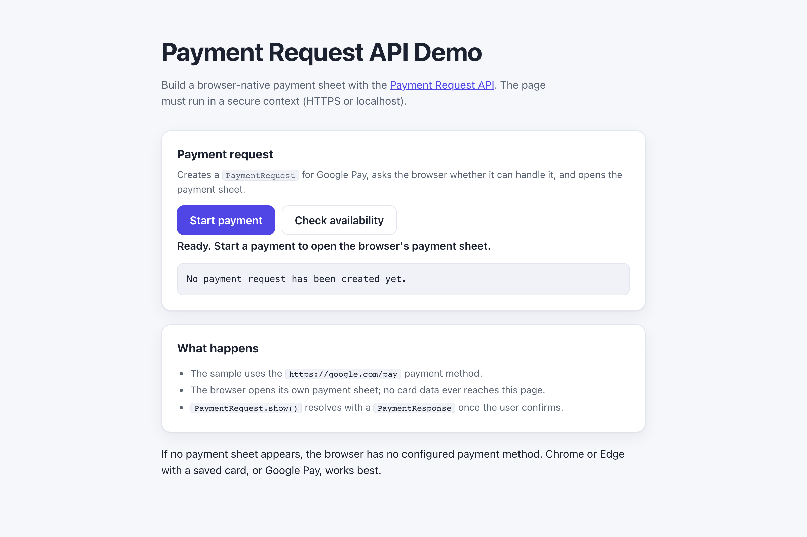

# WebSharper.PaymentRequest

[](https://github.com/dotnet-websharper/PaymentRequest)

WebSharper bindings for the [Payment Request API](https://developer.mozilla.org/en-US/docs/Web/API/Payment_Request_API) —
opening a browser-native payment sheet and handling the response from F# and C# web apps.

The Payment Request API is only available in [secure contexts](https://developer.mozilla.org/en-US/docs/Web/Security/Defenses/Secure_Contexts)
(HTTPS or localhost), and it needs a user gesture to open the payment sheet.

This repository contains:

| Project | Purpose |
| --- | --- |
| `WebSharper.PaymentRequest` | The binding: WIG definitions for `PaymentRequest`, `PaymentResponse`, `PaymentMethodData`, `PaymentDetails`, `PaymentItem`, `PaymentOptions`, `PaymentMethodChangeEvent`, `PaymentRequestUpdateEvent`, `PaymentDetailsModifier`, `PaymentResponseErrorFields`, `SecurePaymentConfirmationRequest`, and the `PaymentShippingType` / `PaymentCompletionResult` enums. |
| `WebSharper.PaymentRequest.Sample` | An ASP.NET Core SPA that builds a payment request, checks whether the browser can handle it, and opens the payment sheet. |

## Live demos

**Try it live:** [Open the sample in your browser](https://dotnet-websharper.github.io/PaymentRequest/)



The sample doubles as the binding's test case: it constructs a `PaymentRequest` with a Google Pay payment method,
calls `canMakePayment()` and `show()`, and reports the outcome in the page.

- **Sample (this repository):** <https://dotnet-websharper.github.io/PaymentRequest/>
- **Source repository:** <https://github.com/dotnet-websharper/PaymentRequest>
- **WebSharper bindings:** <https://websharper.com/bindings>

## Features

- `PaymentRequest` with `show`, `abort`, `canMakePayment`, and `id`, plus the `onpaymentmethodchange` /
  `OnPaymentMethodChange` event handler.
- `PaymentResponse` with `details`, `methodName`, `requestId`, the payer fields, `shippingAddress`, `shippingOption`,
  `complete`, `retry`, and `toJSON`, plus the `onpayerdetailchange` / `OnPayerDetailChange` handler.
- The request-side option dictionaries: `PaymentMethodData`, `PaymentDetails`, `PaymentItem`, `PaymentOptions`,
  `PaymentDetailsModifier`, `PaymentUpdateDetails`, `PaymentResponseErrorFields`, and `Amount`.
- `PaymentMethodChangeEvent` and `PaymentRequestUpdateEvent` for the `updateWith` flow.
- The `PaymentShippingType` and `PaymentCompletionResult` enums.
- `SecurePaymentConfirmationRequest` and `SecurePaymentInstrument` for the Secure Payment Confirmation flow.

## Installation

The binding is not currently published to NuGet. Reference the projects from source:

```bash
git clone https://github.com/dotnet-websharper/PaymentRequest.git
```

```xml
<ItemGroup>
  <ProjectReference Include="path/to/WebSharper.PaymentRequest/WebSharper.PaymentRequest.fsproj" />
</ItemGroup>
```

## Usage

The option dictionaries are `Pattern.Config` types. Their constructor only takes the **required** fields, as
positional arguments; the optional fields are settable properties. The request takes an array of payment
methods, the payment details, and optional payment options.

```fsharp
namespace WebSharper.PaymentRequest.Demo

open WebSharper
open WebSharper.JavaScript
open WebSharper.PaymentRequest

[<JavaScript>]
module Demo =
    let pay () =
        promise {
            // PaymentMethodData has no required fields, so its constructor takes no arguments.
            let method = new PaymentMethodData()
            method.SupportedMethods <- "https://google.com/pay"

            // PaymentItem and Amount require their fields, so they are positional.
            let details = new PaymentDetails()
            details.Total <- new PaymentItem(
                label = "Total",
                amount = new Amount(currency = "USD", value = "1.00")
            )

            let request = new PaymentRequest([| method |], details)

            let! canPay = request.CanMakePayment()
            if not canPay then
                Console.Log("This browser has no matching payment method.")
            else
                let! response = request.Show()
                Console.Log($"Payment completed with {response.MethodName}.")
                do! response.Complete(PaymentCompletionResult.Success)
        }
```

Because `PaymentMethodData` and `PaymentDetails` have no required fields, they are created empty and filled in
through properties. `PaymentItem` and `Amount` do have required fields, so they are built with the constructor.
Only the fields you set are emitted, so optional fields stay out of the generated JavaScript.

`PaymentRequest.Show()` returns a `Promise<PaymentResponse>` that resolves once the user confirms the payment and
rejects when the user dismisses the sheet. `PaymentResponse.Complete()` returns a `Promise<unit>`; call it when the
order has been settled.

## Running the sample

Build the sample in Release and serve its static output:

```bash
dotnet build WebSharper.PaymentRequest.Sample/WebSharper.PaymentRequest.Sample.fsproj -c Release
python3 -m http.server -d WebSharper.PaymentRequest.Sample/wwwroot 8099
```

Open <http://localhost:8099/> and click **Check availability** or **Start payment**. Localhost counts as a secure
context, so the Payment Request API is available.

Alternatively, run the ASP.NET Core host:

```bash
dotnet run --project WebSharper.PaymentRequest.Sample
```

## Building from source

### Prerequisites

- [.NET SDK 10](https://dotnet.microsoft.com/download) or later.

### Build

```bash
dotnet build WebSharper.PaymentRequest.sln -c Release
```

The binding project targets `netstandard2.0`; the sample targets `net10.0`.

## Deployment

Pushing to `master` triggers `.github/workflows/ghpages.yml`, which builds the sample in Release and publishes
`WebSharper.PaymentRequest.Sample/wwwroot` to the `gh-pages` branch.

## Repository layout

```
WebSharper.PaymentRequest/              # binding (WIG definitions)
  Main.fs
WebSharper.PaymentRequest.Sample/       # ASP.NET Core SPA demo
  Client.fs
  Startup.fs
  wwwroot/
    index.html
    site.css
docs/sample.png                         # screenshot used by this README
.github/workflows/ghpages.yml           # build + deploy the sample to GitHub Pages
```

## Notes on the API

- **Secure context:** the Payment Request API is only exposed in secure contexts. Serve the page over HTTPS or from
  localhost.
- **User gesture:** `show()` must be called from a user gesture. Opening the payment sheet without a click is
  rejected by the browser.
- **Payment method:** the payment method is a URL string, for example `https://google.com/pay` (Google Pay) or
  `https://apple.com/apple-pay` (Apple Pay). The method has to be configured in the browser before the sheet can
  open.
- **No matching method:** `canMakePayment()` resolves to `false` when the browser has no configured payment method
  for the request. `show()` then rejects with `NotSupportedError`. Check first and fall back to a regular checkout.
- **Cancellation:** `PaymentResponse` rejects with an `AbortError` when the user dismisses the sheet. Catch it and
  show a neutral message rather than an error.
- **Completing the order:** `PaymentResponse.Complete()` tells the browser how the order ended. Call it with
  `PaymentCompletionResult.Success`, `Fail`, or `Unknown`, and call `retry()` when the payment data needs to be
  corrected.
- **Browser support:** Chrome, Edge, and Safari support the Payment Request API. Firefox supports it behind a
  preference. Headless browsers and some embedded webviews have no payment service, so the request fails there.

## License

Apache 2.0 — see [LICENSE.md](LICENSE.md).
